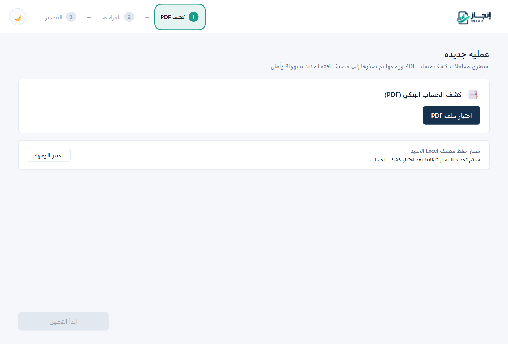
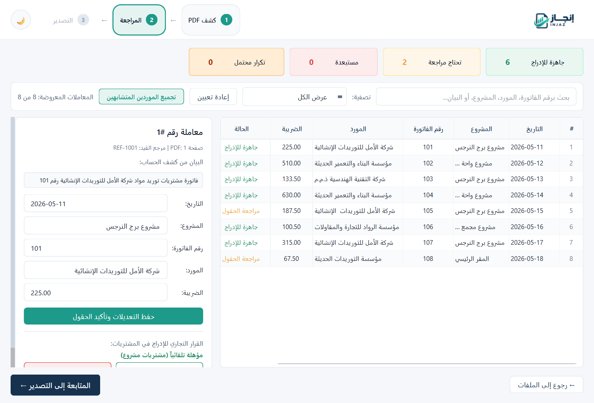
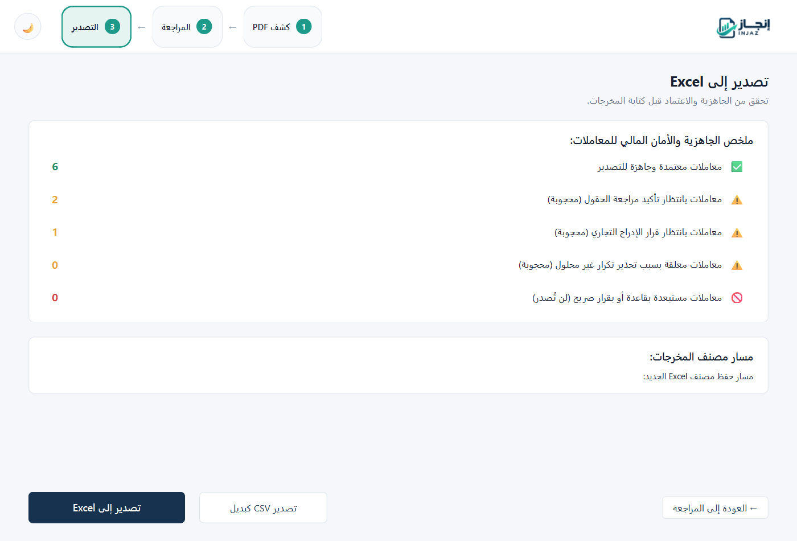
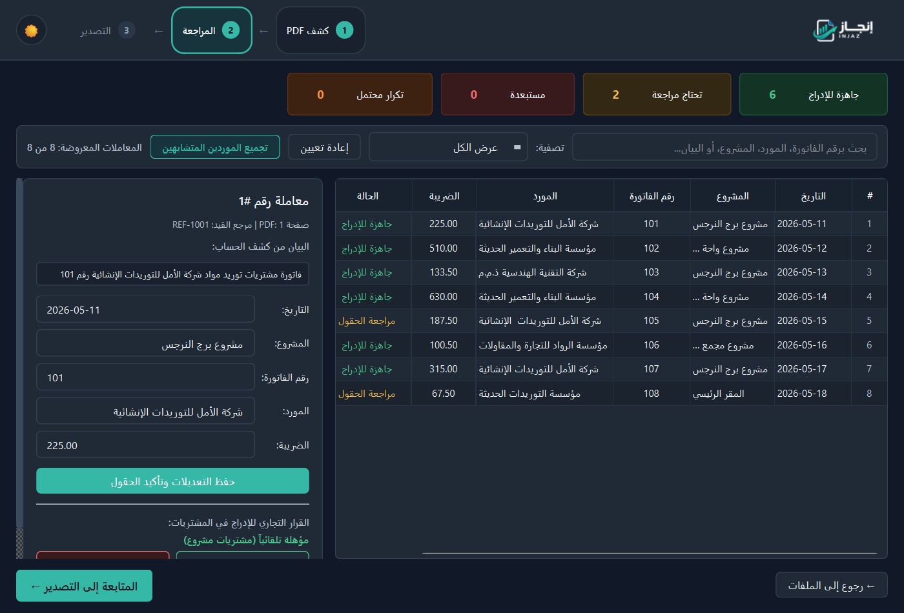

# INJAZ | إنجاز

> **An Arabic-first Windows desktop application for PDF financial transaction extraction, human-in-the-loop review, and standardized XLSX/CSV export.**
>
> نظام مكتبي متخصص لأتمتة استخراج وتدقيق كشوف الحسابات البنكية العربية وتصديرها إلى دفاتر محاسبية معتمدة (Excel / CSV) بواجهة عربية تفاعلية تدعم الوضعين الفاتح والداكن.

---

## Overview

**INJAZ (إنجاز)** solves a widespread operational challenge in Arabic accounting workflows: manual, error-prone data entry from unstructured tabular PDF bank statements into accounting spreadsheets.

Designed for financial auditors, accountants, and finance teams, INJAZ provides a deterministic, coordinate-aware extraction pipeline paired with a human-in-the-loop review interface. It eliminates tedious manual transcriptions while ensuring that financial data undergoes verification before committing to accounting workbooks.

> [!NOTE]
> **Deterministic Engineering, Not AI/ML**: INJAZ uses exact coordinate parsing, deterministic text normalization algorithms, and rule-based accounting classification. It does **not** rely on opaque machine-learning models or external cloud APIs. Ambiguous transactions are flagged for explicit human verification.

---

## Visual Showcase

### 1. Document Selection (Light Theme)
Intuitive Arabic Right-to-Left (RTL) interface for statement selection with automatic output routing and responsive branding.


### 2. Transaction Review & Audit Panel
Real-time summary counters, multi-criteria filtering, and orthogonal decision tracking (technical extraction certainty vs. business eligibility).


### 3. Smart Supplier Grouping & Bulk Corrections
Fuzzy clustering reconciles Arabic font-spacing variations (tatweel, redundant whitespace, alef variants) with single-click canonical name updates.


### 4. Fail-Closed Export Dashboard
Pre-flight audit dashboard verifying that all field reviews and exclusion decisions are resolved before generating export workbooks.


### 5. High-Contrast Dark Theme
Persistent dark mode with curated typography (`Segoe UI`, `IBM Plex Sans Arabic`), accessible contrast ratios, and cohesive design tokens.


---

## Core Features

- **Robust Arabic PDF Extraction**: Coordinate-aware tabular parsing powered by PyMuPDF (`fitz`), resolving reversed RTL character sequences, fragmented font glyphs, and mixed Arabic/Indic numerals.
- **Human-in-the-Loop Review**: Strict orthogonal separation between technical extraction certainty (`VALIDATED` vs `MANUAL_REVIEW`) and business eligibility (`ELIGIBLE`, `EXCLUDED_BY_RULE`, `REQUIRES_USER_REVIEW`).
- **Commercial Rule Classification**: Automatically detects business exclusions (e.g. head-office non-project expenses, utility bills, rent, tax adjustments) according to configurable criteria.
- **Duplicate Detection**: Identifies exact and potential duplicates based on composite keys across dates, invoice numbers, supplier names, references, and amounts.
- **Supplier Name Clustering**: Levenshtein distance and token-set clustering group variant supplier spellings caused by PDF typography artifacts, enabling audit-safe bulk renaming.
- **Fail-Closed Modern Exporter**:
  - Generates brand-new, styled `.xlsx` workbooks from scratch (Navy header theme, zebra striping, currency formats, formulas) without requiring third-party templates.
  - Generates UTF-8-BOM `.csv` files for compatibility with external ERP systems.
  - Refuses to write output if unresolved reviews or unapproved duplicates remain.
- **Native Windows Desktop Experience**: PySide6 (Qt 6) desktop UI with complete Right-to-Left (RTL) widget layout, instant Light/Dark theme switching, and persistent user preferences via `QSettings`.

---

## Application Workflow


1. **Import**: The user selects a read-only PDF statement. The ingestion engine reads text bounding boxes without altering the source file.
2. **Normalize & Classify**: Arabic letters and numerals are normalized; transactions are classified as eligible, excluded by rule, or requiring review.
3. **Audit**: The user reviews flagged items in an interactive table, resolves supplier variants, and confirms duplicate decisions.
4. **Export**: Eligible and approved transactions are atomically written to a freshly generated Excel workbook or CSV file.

---

## Technology Stack

| Layer | Technology | Purpose |
| :--- | :--- | :--- |
| **Language** | Python 3.12 (Standard CPython) | Core application logic and data processing |
| **GUI Framework** | PySide6 6.12.0 (Qt 6.12) | Native RTL Arabic user interface & widgets |
| **PDF Extraction** | PyMuPDF 1.28.2 (`fitz`) | Coordinate-based spatial text extraction |
| **Spreadsheet Engine** | OpenPyXL 3.1.5 | Native `.xlsx` workbook generation & styling |
| **Image & Icon Processing** | Pillow 12.3.0 | Multi-resolution icon and brand asset handling |
| **Packaging & Distribution**| PyInstaller 6.22.3 & Inno Setup 6 | Standalone Windows executable & installer |
| **Test Automation** | Pytest 9.1.1 | Hermetic test suite with synthetic fixtures |

---

## Windows Installation

Pre-built Windows installers are available on the [GitHub Releases](https://github.com/Mtgazer/INJAZ/releases) page.

1. Download **`INJAZ_Setup_1.0.1.exe`** from the latest release.
2. Run the installer. It installs into the current user's profile (`%LOCALAPPDATA%\Programs\INJAZ`) without requiring administrative elevation.
3. Launch **إنجاز - INJAZ** from the Start Menu or the optional Desktop shortcut.
4. An uninstaller is provided via Windows Settings / Control Panel and the Start Menu folder.

For instructions on building the standalone executable and installer from source, consult [`BUILD_WINDOWS.md`](BUILD_WINDOWS.md).

---

## Developer Setup

### Prerequisites
- **Python 3.12** (64-bit standard CPython recommended)
- **Git**

### Installation

```powershell
# 1. Clone the repository
git clone https://github.com/Mtgazer/INJAZ.git
cd INJAZ

# 2. Create and activate a virtual environment
py -3.12 -m venv .venv
.\.venv\Scripts\Activate.ps1

# 3. Install dependencies
pip install --upgrade pip
pip install -r requirements.txt
```

### Running the Application

```powershell
python -m injaz
```

### Running the Test Suite

The repository includes **170 automated tests** covering Arabic normalization, business rules, duplicate detection, supplier grouping, UI components, background workers, and fail-closed exporters.

All tests run hermetically using synthetic, fictitious fixtures:

```powershell
pytest -v
```

---

## Repository Structure

```text
INJAZ/
├── .github/workflows/       # GitHub Actions CI automated test workflow
│   └── tests.yml
├── assets/                  # Brand icons and logos (square multi-res ICO & PNGs)
│   ├── app_icon.ico
│   ├── app_icon.png
│   ├── dark_logo.png
│   ├── icon_mark.png
│   └── light_logo.png
├── docs/                    # Demonstration screenshots and guides
│   └── screenshots/
├── injaz/                   # Application package
│   ├── __init__.py          # Version metadata (1.0.1)
│   ├── __main__.py          # Entrypoint & Windows DLL resolution
│   ├── csv_writer.py        # UTF-8-BOM CSV export engine
│   ├── duplicates.py        # Duplicate detection algorithms
│   ├── engine.py            # Core extraction orchestration
│   ├── excel_writer.py      # Legacy Excel population engine
│   ├── main.py              # Qt application bootstrap & RTL setup
│   ├── models.py            # Dataclasses & audit status models
│   ├── normalizer.py        # Arabic text & numeral normalizer
│   ├── paths.py             # Runtime asset path resolution
│   ├── pdf_extractor.py     # PyMuPDF coordinate-based parser
│   ├── rules.py             # Accounting rules classifier
│   ├── supplier_matcher.py  # Fuzzy supplier clustering
│   ├── verify_cli.py        # Automated end-to-end verification harness
│   ├── xlsx_exporter.py     # Native XLSX workbook generator
│   └── ui/                  # PySide6 user interface
│       ├── main_window.py   # Main window container & step routing
│       ├── theme.py         # Light/Dark design tokens & styles
│       ├── workers.py       # Asynchronous background threads (QThread)
│       ├── components/      # Reusable widgets and modal dialogs
│       ├── models/          # Table models (QAbstractTableModel)
│       └── pages/           # Step 1, Step 2, and Step 3 views
├── tests/                   # Automated test suite (170 tests)
│   ├── conftest.py          # Synthetic fixtures & Qt cleanup fixtures
│   ├── fixtures/            # Anonymized synthetic PDFs and templates
│   └── test_*.py
├── .gitignore               # Strict exclusion rules for build & private artifacts
├── BUILD_WINDOWS.md         # Step-by-step Windows build & packaging documentation
├── INJAZ.spec               # PyInstaller build specification
├── installer.iss            # Inno Setup 6 installer script
├── README.md                # Project documentation
└── requirements.txt         # Runtime and testing dependencies
```

---

## Privacy & Synthetic Data Policy

This repository is published as a software engineering portfolio project:
- **Zero Real Financial Data**: All real client bank statements, private accounting records, tax numbers, and real commercial names have been excluded and archived externally.
- **Hermetic Testing**: The test suite, screenshots, and verification runs rely strictly on fictitious synthetic fixtures generated programmatically with fake vendor names, invoice numbers, and transaction amounts.
- **Source Immutability**: The extraction engine accesses input documents in read-only mode and never modifies original PDF files.

---

## Known Limitations

- **Scanned Documents**: INJAZ requires text-layer digital PDFs. Scanned bitmap PDFs without OCR text layers require an OCR preprocessing step prior to ingestion.
- **Non-Standard Statement Layouts**: Coordinate heuristics are optimized for standard tabular Arabic statements; highly atypical table layouts may require additional column mapping rules.
- **Executable Signing**: The prebuilt installer binary is not digitally signed with a commercial EV certificate. Windows SmartScreen may display an unrecognized publisher notification during installation.

---

## License

This repository is published for portfolio and demonstration purposes. An open-source license decision remains pending; all rights are reserved by the author. Re-distribution or commercial use without authorization is prohibited.
